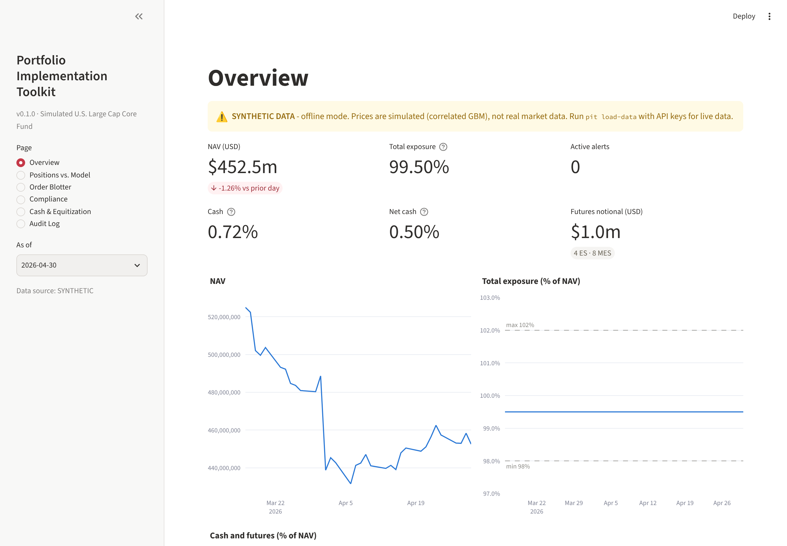
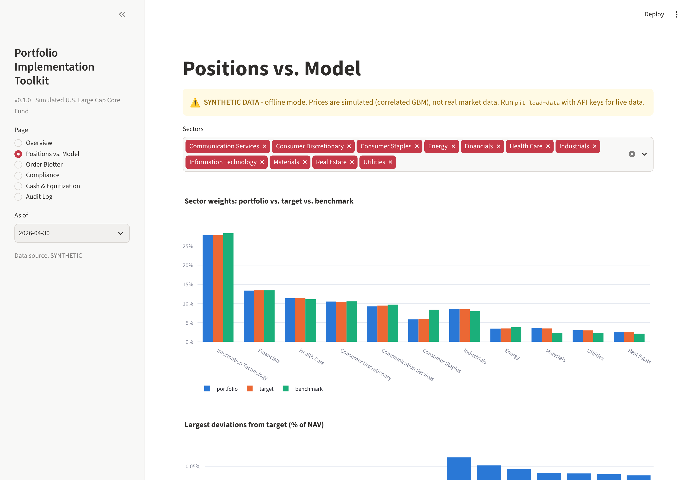
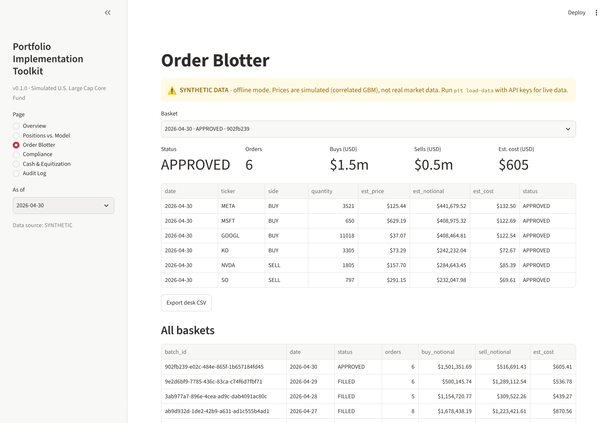
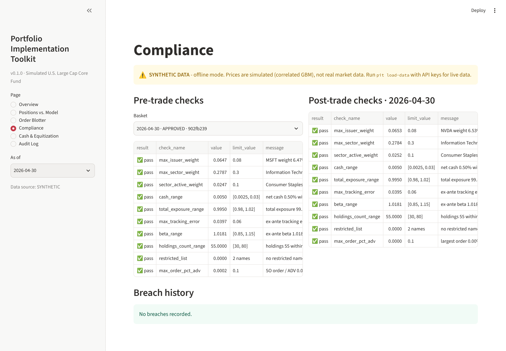
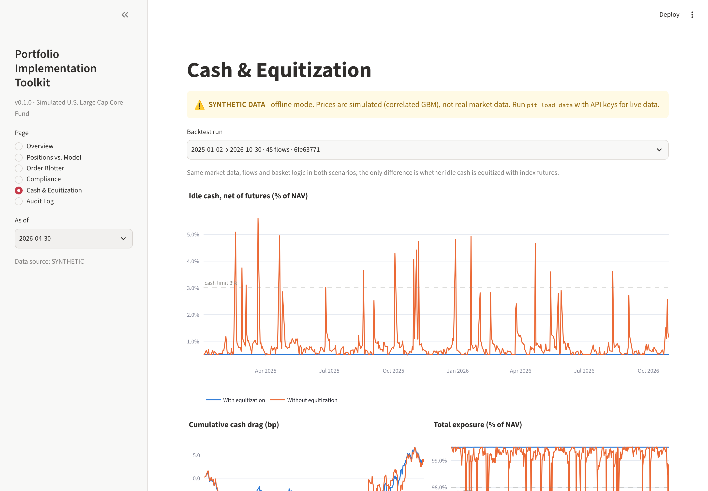
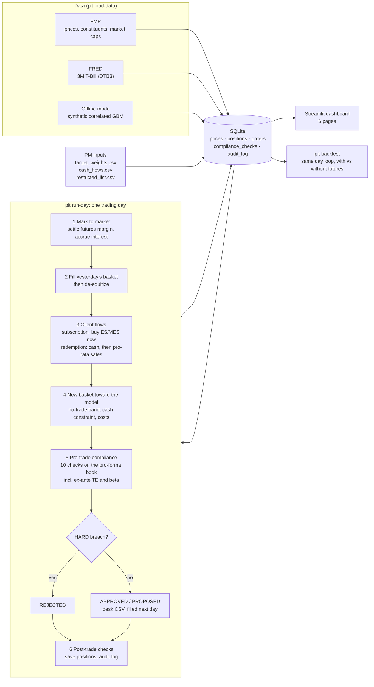

# Portfolio Implementation Toolkit

[](https://github.com/emilio-pirez/portfolio-implementation-toolkit/actions/workflows/ci.yml)


[](LICENSE)

**A simplified simulation of a core portfolio manager's daily implementation
workflow: cash equitization with index futures, basket generation, pre-trade
compliance and monitoring.**



## Why

A core equity PM is handed a model portfolio and has to *implement* it, every
day, without breaking anything:

- **Cash drag.** Client subscriptions arrive as cash. Until the stocks are
  bought, that cash is out of the market and the fund lags its benchmark. The
  standard fix is to **equitize** it with index futures the same day and unwind
  them as the stock basket fills.
- **Limits.** Every basket must respect issuer, sector, cash, exposure,
  tracking-error, liquidity and restricted-list limits **before** it reaches
  the trading desk.
- **Traceability.** Every flow, trade, breach and approval must be
  reconstructible after the fact.

This project builds that workflow end to end in Python. It is **not** an alpha
model or a trading strategy: the target weights are an input (the PM's model,
`data/inputs/target_weights.csv`). The value is in implementing them well,
controlling risk and documenting every decision.

## Demo

`streamlit run app/dashboard.py` opens six pages. On a fresh clone the first
launch loads a prebuilt offline demo (`data/demo/demo.db`) in a few seconds.
A banner marks every page whenever the data is synthetic.

| | |
|---|---|
|  **Positions vs. Model.** Portfolio vs. target vs. benchmark, by sector and stock |  **Order Blotter.** Every basket, its status and costs; desk CSV export |
|  **Compliance.** Pre- and post-trade checks, HARD / SOFT, breach history |  **Cash & Equitization.** Idle cash and cash drag, with vs. without futures |

The sixth page is the **Audit Log**: every event, filterable, with its full
details ([screenshot](docs/screenshots/06_audit_log.png)).

## Architecture



## Key results

Backtest on **synthetic data** from 2-Jan-2025 to 30-Oct-2026: 477 trading days,
45 random client flows of 0.5-5 % of NAV, USD 500 m fund, 55-stock model.
The stock basket is filled one day after the flow (lag 1) or three days after
(lag 3).

| | Lag 1: with equitization | Lag 1: without | Lag 3: with | Lag 3: without |
|---|---|---|---|---|
| Max idle cash (% NAV) | 0.50 % | 5.61 % | 0.50 % | 7.79 % |
| Avg total exposure | 99.50 % | 99.13 % | 99.50 % | 98.65 % |
| Cash drag, realized (bp/yr) | 2.1 | 2.2 | 2.1 | 12.1 |
| Cash drag, expected (bp/yr) | 1.6 | 2.8 | 1.6 | 4.3 |
| Days breaking a HARD limit (post-trade) | **0** | **26** | **0** | **95** |

**Compliance:** 476 baskets were generated in the lag-1 run. None was blocked
by a HARD check and none raised a SOFT alert, because the basket generator
caps buys at the available cash and the model sits inside every limit.
Without equitization, the *end-of-day* book still broke the 98 % exposure /
3 % cash limits on 26 days. Blocking is covered by the tests: for example, a
basket that puts 12 % in one name is REJECTED on both the issuer and the
sector limit.

**How to read it.** Equitization keeps the fund fully exposed and inside its
limits every day. With next-day execution the return benefit is small
(~1 bp/yr expected) and within the noise. It grows with how long cash would
otherwise wait: about +8 bp/yr of tracking difference at lag 3. The
remaining ~2 bp/yr of drag comes from the 0.5 % cash buffer, which is never
equitized by design.

## Quickstart

Python 3.11+.

```bash
git clone https://github.com/emilio-pirez/portfolio-implementation-toolkit.git
cd portfolio-implementation-toolkit
python -m venv .venv && source .venv/bin/activate
pip install -e ".[dev]"
streamlit run app/dashboard.py
```

The first launch copies the prebuilt offline demo database; the dashboard opens
in seconds. On a fresh clone the whole path (clone, install, open) takes about
2 minutes. To rebuild the demo from scratch: `pit demo --snapshot-out data/demo/demo.db`.

Everything also runs from the command line. Days are processed once and in
order, so start from an empty database (the demo above already processed
March-April 2026):

```bash
rm -f data/db/toolkit.db             # start over
pit load-data --offline              # synthetic data, no API keys needed
pit run-day --date 2026-03-16        # USD 25 m subscription: equitize, basket, compliance
pit run-day --date 2026-03-17        # basket filled, futures unwound
pit backtest                         # with vs without equitization (~1 minute)
pytest                               # 202 tests, ~2 minutes
```

**Live data (optional).** Copy `.env.example` to `.env` and add free keys from
[Financial Modeling Prep](https://site.financialmodelingprep.com/developer/docs) and
[FRED](https://fred.stlouisfed.org/docs/api/api_key.html), then run
`pit load-data`. Without keys, or if a provider fails, the toolkit falls back to
clearly labelled synthetic data.

| Command | What it does |
|---|---|
| `pit load-data [--offline]` | Load prices, benchmark weights, T-Bill rate and model weights into SQLite |
| `pit run-day --date D` | Process one day: mark to market, fill yesterday's basket, flows, futures, new basket, compliance, audit log |
| `pit approve / reject --batch-id ID --reason ...` | Manual decision on a basket with SOFT alerts |
| `pit export-basket --batch-id ID --out file.csv` | Trading-desk file (`ticker, side, quantity, est_price, est_notional`) |
| `pit backtest [--start --end --flows --lag]` | Same workflow over a period, with vs. without equitization |
| `pit demo [--skip-backtest] [--snapshot-out FILE]` | Build the offline demo database used by the dashboard, or regenerate the committed snapshot |
| `pit show-config` / `pit db-schema` | Validate `config.yaml` / print the database DDL (SQLite or Postgres) |

## What's inside

| Module | Responsibility |
|---|---|
| `equitization` | Futures fair value `F = S·e^((r−q)T)`, quarterly expiries and rolls, contract sizing (floor ES + round MES), futures overlay for subscriptions, de-equitization and redemptions |
| `orders` | Basket toward the model: lot rounding, 5 bp no-trade band, cash constraint, linear cost model, desk CSV |
| `compliance` | 10 checks on the pro-forma portfolio. HARD blocks the basket (REJECTED); SOFT requires approval with a written reason |
| `risk` | Beta, ex-ante tracking error with the benchmark as an asset, Ledoit-Wolf covariance, cash drag |
| `workflow` | `run-day` (one pure daily step, persisted with an append-only audit trail) and the backtest |
| `data`, `db` | FMP / FRED clients with retries, SQLite cache, offline generator; SQLAlchemy schema with CHECK constraints |
| `app/dashboard.py` | Six Streamlit pages over the same database |

| Check | Limit | Severity |
|---|---|---|
| Max issuer weight | 8 % | HARD |
| Max sector weight | 30 % | HARD |
| Sector active weight vs. benchmark | ±10 pts | SOFT |
| Cash, net of futures | 0.25 % - 3 % of NAV | HARD |
| Total exposure (stocks + futures) | 98 % - 102 % | HARD |
| Ex-ante tracking error | 6 % | SOFT |
| Ex-ante beta | 0.85 - 1.15 | SOFT |
| Number of holdings | 30 - 80 | SOFT |
| Restricted list | none held or bought | HARD |
| Order size vs. 20-day ADV | 10 % | SOFT |

Every limit and assumption lives in [`config.yaml`](config.yaml) and is
validated on load.

## Methodology

[docs/methodology.md](docs/methodology.md) has the formulas, assumptions and
a worked example for every module: futures fair value, contract sizing, the
overlay, basket construction, compliance, the risk model, the daily workflow
and the backtest. [docs/interview_notes.md](docs/interview_notes.md) has short
answers to the questions this project is meant to support.

## Limitations

- **Futures are priced at theoretical fair value.** A real desk uses the
  traded contract price, which embeds the market's financing spread; the roll
  spread is not simulated.
- **Execution at the close**, with a linear cost model (commission + half
  spread) and no market impact. Baskets are filled in full at the next close.
- **Benchmark weights are a single snapshot** of market caps, not a
  historical index-weight series.
- **The offline mode is synthetic.** All results above use simulated prices;
  they illustrate the mechanics, not real performance.
- **Simplified calendar and settlement.** Monday-Friday business days without
  exchange holidays. Trades settle at the close (no T+1). Initial margin is
  not modelled beyond the cash buffer.
- **Risk model:** sample covariance with shrinkage, not a factor model (Barra,
  Axioma).
- **Out of scope:** FX and international stocks, ETF create/redeem,
  transition management, taxes. These are possible extensions.

## Deploy the dashboard (Streamlit Community Cloud)

The repository is ready for [Streamlit Community Cloud](https://share.streamlit.io):
`requirements.txt` installs the package, and `config.yaml` is found from the
repository root. On start, the empty database is restored from
`data/demo/demo.db`. In the deploy form use branch `main`, main file
`app/dashboard.py` and Python 3.12.

## Project layout

```
config.yaml              every limit and assumption, in one reviewable file
data/inputs/             model weights, example flows, restricted list, offline universe
data/demo/demo.db        prebuilt offline demo database (synthetic) for the dashboard
src/pit/                 package: data, db, portfolio, equitization, orders,
                         compliance, risk, workflow, dashboard queries, CLI
app/dashboard.py         Streamlit dashboard (6 pages)
docs/                    methodology, interview notes, screenshots
tests/                   202 tests, no network calls (HTTP is mocked)
```

## Author

**Emilio Pirez**, Finance, Universidad de Monterrey (UDEM), class of December 2026.

[LinkedIn](https://www.linkedin.com/in/emilio-pirez-525b44311/) · [GitHub](https://github.com/emilio-pirez)

Released under the [MIT License](LICENSE).
